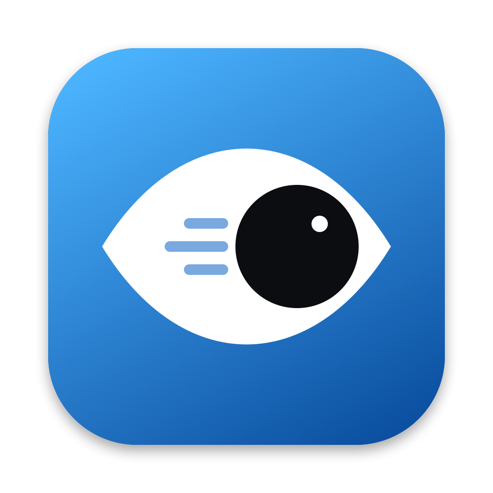

<p align="center"></p>

<h1 align="center">Lookshift</h1>

<p align="center">Look at a window, a pane or another screen, and your keyboard focus moves there.<br>
Runs entirely on your Mac. No account, no cloud, nothing recorded.</p>

<p align="center">
  <a href="https://github.com/samapara/Lookshift/actions/workflows/ci.yml"></a>
  <a href="https://github.com/samapara/Lookshift/actions/workflows/codeql.yml"></a>
  <a href="https://scorecard.dev/viewer/?uri=github.com/samapara/Lookshift"></a>
  <a href="https://github.com/samapara/Lookshift/releases/latest"></a>
  <a href="LICENSE"></a>
</p>

---

Lookshift is a menu-bar app for macOS. It uses your Mac's built-in camera to see where your head and eyes point, then brings the window you're looking at to the front, so you can start typing without reaching for the mouse or ⌘-Tab.

- **Within one screen:** focus the window, or the pane inside it (editor splits, terminal panes, browser columns), that you look at.
- **Across screens:** with a monitor beside your laptop, look at it and focus jumps there; the cursor follows if you want.
- **Out of your way:** focus never moves while you're typing or using the mouse. The camera turns off when you step away, lock the screen or pause Lookshift.

## Install

1. Download **Lookshift-x.y.z.dmg** from the [latest release](../../releases/latest).
2. Open it and drag **Lookshift** into **Applications**.
3. Open Lookshift from Applications. macOS will say it can't check the app for malware, because Lookshift is free and isn't signed with a paid Apple certificate. Click **Done**, then open **System Settings → Privacy & Security**, scroll down and click **Open Anyway**. You only do this once.
4. The setup window walks you through the rest, in about a minute:
   1. **Camera:** to see where you're looking.
   2. **Accessibility:** to bring windows to the front.
   3. **Calibrate window focus:** follow a dot around the screen for 25 seconds.
   4. **Calibrate your second screen:** only if you use one. Look at each screen when asked, about 15 seconds.

Requires macOS 14 Sonoma or later and a MacBook (Lookshift uses the built-in camera). Apple silicon and Intel are both supported.

## Using it

Lookshift lives under the eye icon in the menu bar.

| | |
|---|---|
| Pause or resume | **⌃⌥⌘H**, or the menu. You can change the shortcut in Settings. |
| See what it sees | Settings → **Show gaze dot**. Teal is steady, amber is about to switch, blue is waiting for you to stop typing. |
| Too jumpy or too slow | Settings → **Delay for windows and panes** and **Delay before switching**. |
| Monitor moved to the other side | Nothing to do; screen calibration flips automatically. |
| Accuracy feels off | Calibrate again from the menu, facing the screen in your usual light. |

## Privacy

- Video frames go from the camera straight to Apple's Vision framework in memory and are thrown away. Nothing is saved, and only a few numbers per frame (head angle, eye position) are kept, for a fraction of a second.
- Lookshift contains no networking code at all. You can check that it uses no networking APIs; this prints nothing:

  ```sh
  nm -u /Applications/Lookshift.app/Contents/MacOS/Lookshift | grep -E "URLSession|NSURLConnection|_socket|CFSocket|_nw_"
  ```
- Settings and calibration are stored in macOS's normal preferences on your Mac (`io.github.samapara.Lookshift`).
- The camera light is on only while Lookshift is tracking. It turns off when you're away (no face for 20 seconds while idle, or after the idle time you set), when the screen locks, when the Mac sleeps and when you pause.

## Security

Every push runs the tests, GitHub's CodeQL code scanner and checks that the app has no networking code and no developer options. OpenSSF Scorecard grades the repository's security practices publicly, every GitHub Action is pinned to an exact commit, and each release file carries a signed record of the commit and workflow that built it. Details, and how to report a problem privately, are in [SECURITY.md](SECURITY.md).

To check that a download really came from this repository (releases from 1.0.2 on):

```sh
gh attestation verify Lookshift-1.0.2.dmg -R samapara/Lookshift
```

## Uninstall

Quit Lookshift from its menu, then drag it from Applications to the Bin. To remove its settings too:

```sh
defaults delete io.github.samapara.Lookshift
```

and remove it from **System Settings → Privacy & Security → Camera** and **Accessibility**.

## How it works

Each frame, Vision finds your face and its landmarks. Lookshift measures how far your nose sits from the middle of your eyes (head turn and tilt), where the pupils sit inside each eye (from Vision and from a search for the darkest spot), and where your face is in the picture.

- **Screens:** calibration fits a single "which screen" axis to those numbers (a Fisher linear discriminant), weighting the eye signals only if they separate the screens reliably for your face and light. Smoothing, a dwell time and hysteresis stop it flickering at the boundary.
- **Windows and panes:** the 9-dot calibration fits a ridge regression from the same numbers to a point on the screen, and reports its accuracy from leave-one-dot-out testing. The window or pane under that point gets focus after a short dwell, found through the macOS Accessibility API.

The logic lives in `LookshiftCore`, which has no camera or UI code and is covered by unit tests.

## Build from source

Needs Swift 6 (Xcode 16 or later, or just the Command Line Tools).

```sh
scripts/test.sh                              # unit tests
scripts/build-app.sh                         # dist/Lookshift.app, universal, ad-hoc signed
scripts/make-dmg.sh                          # dist/Lookshift-<version>.dmg
open dist/Lookshift.app
```

Debug builds (`swift build`) have two developer options. Release builds leave them out on purpose, so no other program can use Lookshift's camera permission through them.

- `.build/debug/Lookshift --print-readings` streams the raw head and eye numbers to the terminal.
- `.build/debug/Lookshift --preview-onboarding <folder>` saves the setup window in each first-run state as PNG files.
- `swift scripts/make-art.swift` redraws the icon and the .dmg background.

Ad-hoc signed builds get a new identity each time, so macOS asks for Accessibility again after every rebuild. Remove the old entry from the list and add the new app.

Releases are built by GitHub Actions when a `v*` tag is pushed (`.github/workflows/release.yml`). Set the `DEVELOPER_ID` and notarization secrets described there to ship signed and notarized builds.

## License

[MIT](LICENSE) © 2026 Shubham Mapara
